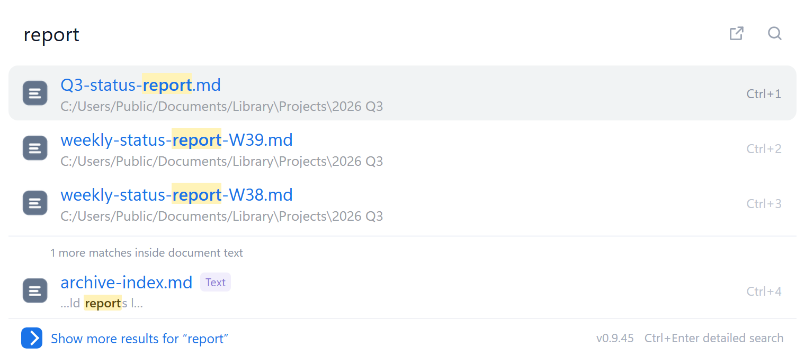
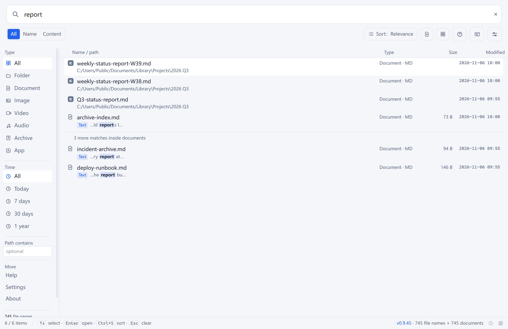
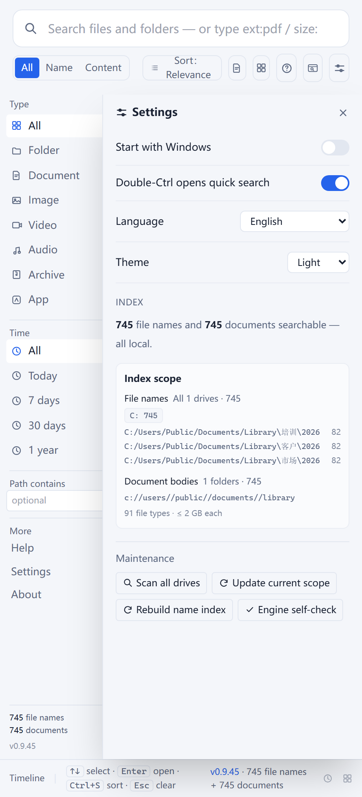

# Second Brain · Local Document Search

[简体中文](README.md) | **English**

Turn the documents scattered across your drives into a local knowledge base you can actually search. **Full-text search, Chinese-friendly, fully offline** — nothing leaves the machine, no account, no server.

Python + SQLite FTS5. One `brain.db` holds every extracted document body; it keeps working with the network unplugged.

> **Why not Everything?** It knows what a file is called, not what it says. You remember a sentence from a document but not which file it lives in — that is the gap this tool fills.
> **Why not an online notebook?** Contracts, medical records and internal material do not belong on someone else's server.

<p align="center"></p>

<p align="center"><sub>Press Ctrl twice and a search box appears. Name matches come first, content matches follow — both searched at once</sub></p>

---

## Download

Grab the latest `SecondBrain-Setup-vX.Y.Z.exe` (about 180 MB) from [Releases](https://github.com/bslnssb/second-brain/releases) and run it.

| | |
|---|---|
| OS | Windows 10 / 11 (64-bit) |
| Installed size | About 330 MB (`SecondBrain.exe` + `_internal/`) |
| Admin rights | Not required — a per-user install works |
| Network | After install, **fully offline**; the OCR model ships with the app |
| Uninstall | Settings → Apps → Uninstall, or just delete the folder |

Two things that look like failures but are not:

1. **The app is not code-signed**, so Windows SmartScreen shows "Windows protected your PC" on first run. Click **More info → Run anyway**. That is what an unsigned binary looks like, not malware.
2. **Missing WebView2 means no window** (occasional on older Win10 machines). The app prints a download link; after installing it, launch again — or just open `http://127.0.0.1:8765` in a browser.

On first launch you pick the folders to index and the database builds itself. **Search works immediately**; results grow as the scan progresses.

## What it does

- **Quick search on double Ctrl**: press Ctrl twice anywhere, a search box drops down from the top. `↑↓` to move, `Enter` to open, `Ctrl+1~9` for the Nth row, `Ctrl+Enter` to reveal in Explorer, `Esc` to dismiss
- **File names and document text in one place**: name matches come from the index (sub-millisecond); after 300 ms of idle it also adds "this document mentions it" hits, tagged and with the matching sentence
- **Pinyin search**: type `azb` to find 安装包 (setup package), `xzrs` for 行政人事. Initials and full pinyin both work
- **Real system icons**: each row shows the same icon Explorer would (PDF red, Word blue, Excel green, an exe shows its own icon)
- **Chinese full-text search**: 3+ characters use an FTS5 trigram index with highlighting; 1–2 characters fall back to `LIKE`
- **Automatic OCR**: image-only PDFs are recognised on the first 6 pages (20 s per document), offline Chinese OCR
- **Index scope is visible**: the settings panel shows which drives are indexed, how many entries each holds, which folders feed the document index, and what is excluded
- **Exclusions apply to both layers**: `exclude_dirs` filters the file-name index and the document index, and whole subtrees are pruned during the walk (on this machine, excluding game libraries took 600k entries down to 200k)
- **Incremental by default**: changed files are re-indexed, deleted ones are pruned, unchanged ones are skipped; a long index run resumes where it stopped
- **Five UI languages**: 中文 / English / Español / Português / हिन्दी, following the system or set manually
- **No uploads**: parsing, OCR and indexing happen locally; the HTTP server binds `127.0.0.1` only

## Screens

The main window is the detailed view: name and content matches in separate bands, highlighted snippets, filters by type and path, plus a timeline.

<p align="center"></p>

<p align="center"></p>

When the quick search box is empty it lists recently opened files, so often you do not need to type at all:

<p align="center"></p>

## How it compares to Everything and Listary

**If what you want is "press Ctrl twice, type, open a file", Second Brain is enough.** The interaction follows the familiar pattern: double Ctrl to summon, one input, nine rows, `Ctrl+1~9` to jump, `Esc` to dismiss, pinyin matching, real icons, recent files when empty, segmented paths.

**It also shows content matches inside the quick window** — neither of those tools looks inside files, so this part is unique to Second Brain.

| | "I know what it is called" | "Which file contains this sentence?" | Index freshness |
|---|---|---|---|
| **Everything** | Best in class, reads the NTFS file table, real time | No | Live |
| **Listary** | Strong, with pinyin and a launcher | No | Live |
| **Second Brain** | Good enough: file and folder names (game libraries excludable — 200k entries here), around 0.2 ms per prefix query, pinyin included | **In the quick window** | Manual "Rebuild name index" |

**What it does not do**: Listary can also jump folders inside Open/Save dialogs, select files in Explorer, and keep its index updated from NTFS in real time. So if you use Listary as a file-dialog accelerator, the two do not conflict — install both.

> Second Brain is an independent implementation: it uses no code, icons or UI assets from the products above, and has no affiliation with them. Product names appear only to explain the differences.

## First run

1. Double-click `SecondBrain.exe` — the main window opens (closing it does not quit; the app stays in the tray waiting for a double Ctrl)
2. Open **Settings** and click **Scan all drives** — it proposes the folders worth indexing and lets you confirm
3. Indexing starts on its own; the search box does not wait for it
4. Day to day: **Update current scope** after adding documents; **Rebuild name index** after moving large numbers of files

The index scope lives in `scope.json` next to the program, with two fields:

| Field | Meaning |
|---|---|
| `include_dirs` | Folders to index (prefix match; also the first scan roots for the name index) |
| `exclude_dirs` | Keywords; any path containing one is skipped (applies to both the name index and the document index) |

One more safety net: any subtree whose directory name contains 小说 / 书城 / 书架 / novel / fiction / 轻小说 / 网文 (novel-related words) is never touched — not even scanned.

## Query syntax

Type plain words. Multiple words are ANDed, and each word is treated as a literal phrase, so `C++`, `node.js`, `a-b`, `"quotes"` and `(parens)` are all searchable without breaking FTS syntax.

The main input also understands a few prefixes, applied as you type:

| Syntax | Meaning |
|---|---|
| `ext:pdf` | Only that extension |
| `size:>10m` | Filter by size (`k` / `m` / `g`) |
| `dm:7d` | Modified within the last 7 days (`h` / `d` / `w` / `m` / `y`) |
| `-draft` | Exclude anything containing that word |
| `folder/` | Folders only |
| `content:` | Search document text only, ignore file names |

File names take part in retrieval too: a document whose body never mentions the word but whose file name does will still be found, with the hit highlighted in the name.

## Command line and automation

The exe accepts startup arguments, handy for launcher integration:

| Command | Effect |
|---|---|
| `SecondBrain.exe reimbursement` | Open the main window with results |
| `SecondBrain.exe --settings` | Open the main window with settings expanded |
| `SecondBrain.exe --silent` | Stay in the tray, no window, wait for double Ctrl |
| `SecondBrain.exe --mini` | Show the quick search box on launch |
| `SecondBrain.exe --lang en reimbursement` | Force the English UI (`zh` likewise) |

URL parameters for the browser UI:

| Parameter | Effect |
|---|---|
| `?q=keyword` | Open with results |
| `?panel=settings` | Open with settings expanded (legacy `?cfg=1` still works) |
| `?lang=zh` / `?lang=en` | Force that language for this link |

Example: `http://127.0.0.1:8765/web/?q=report&lang=en`

**Start with Windows**: there is a switch in settings; you can also drop a shortcut into `shell:startup` with `--silent` appended to the target.

## Running from source

Python 3.10+ (3.12 recommended).

```bash
pip install -r requirements.txt
python app_window.py          # desktop window (start.bat on Windows)
python brain.py serve         # or browser UI only: http://127.0.0.1:8765
```

Prepare the scope file before the first run:

```bash
cp scope.example.json scope.json        # Windows: copy scope.example.json scope.json
```

List your folders in `include_dirs` (backslashes must be doubled), then:

```bash
python brain.py update        # scan → incremental index → prune
python brain.py index scope.json   # document index only (resumable)
python brain.py search keyword [count] [ext] [path contains]
python brain.py prune         # drop entries for deleted files
python brain.py selftest      # quality self-test, writes eval_report.txt
python scan_docs.py           # scan only, produce the file list
```

The frontend lives in `web/` (React + TypeScript + Tailwind). Rebuild it after changes:

```bash
cd web
npm install
npm run build      # output in web/dist, the backend serves it directly
npm test           # 35 unit tests
```

Building the exe (Windows, requires PyInstaller):

```bash
cd release/github
python -m PyInstaller --noconfirm --clean second-brain-app.spec && python -B stage_app.py
python -B make_payload.py && python -m PyInstaller --noconfirm --clean SecondBrain-Setup.spec && python -B stage_setup.py
```

## Supported formats and limits

| Format | Supported | Notes |
|---|---|---|
| `.txt` / `.md` | Yes | Detects UTF-8 / GBK / UTF-16, with a gb18030 fallback |
| `.pdf` | Yes | pypdf reads the first 20 pages; image-only PDFs are OCR'd (first 6 pages, 20 s budget) |
| `.docx` / `.pptx` / `.xlsx` / `.epub` | Yes | zip + XML extraction, no external dependency |
| `.html` / `.htm` | Yes | Tag stripping |
| `.rtf` | Yes | Control words stripped; Chinese decoded via the document's `\ansicpg` |
| `.doc` / `.xls` / `.ppt` / `.wps` / `.et` / `.dps` | Machine dependent | Uses a local Office / WPS install; otherwise recorded as "legacy format" and skipped |
| Encrypted documents | No | Recorded as "encrypted" and skipped, never polluting the index |
| Document body | 2 MB cap | Longer text is truncated so one huge file cannot stall indexing |

Every failure is recorded with a reason (encrypted / corrupted / empty / temporary / legacy format) and summarised after each run, so nothing disappears silently.

## Privacy

- Parsing, OCR and indexing all run locally; no network requests are made
- The HTTP server binds `127.0.0.1` only, validates `Host` / `Origin`, requires same-origin requests for `/api/*`, and accepts only `application/json` bodies up to 64 KB
- Opening files and reading thumbnails require a path that is already indexed
- The index is just `brain.db` in the program folder — delete it and everything is gone
- `.gitignore` excludes `brain.db`, `scan_raw.csv` and `scope.json`; they contain your text and local paths

## Quality self-test

`python brain.py selftest` builds a database from synthetic data in a temp folder and checks retrieval accuracy, cross-validation between two PDF extractors, OCR character error rate, malformed-file fuzzing and database integrity — without touching your real index:

```
[PASS] A1 retrieval recall@3 = 5/5 — recall@1=5/5, MRR=1.000
[PASS] A2 relevance ranking — bm25 ordering in effect
[PASS] A3 encrypted PDF never indexed, never searchable
[PASS] B  extractor agreement pypdf vs pymupdf = 1.00
[PASS] C  OCR character error rate CER = 7.3%
[PASS] D  malformed-file fuzz: 9 cases — zero crashes
[PASS] E  SQLite/FTS5 integrity check
[PASS] F  changed files are re-indexed automatically
[PASS] G1 failure attribution / G2 prune cleanup
OVERALL: PASS
```

There is also `qa_test.py` for release runs: edge-case input (FTS syntax, wildcards, injection shapes, very long queries), latency on a real library, concurrent requests, `/open` privilege checks, and untranslated strings in the English UI. Read-only; it writes `QA_REPORT.md`. Last run on an 8,626-document / 2.37 GB library: 98 passed / 0 failed / 1 warning, with the 7 defects found documented in [QA_FINDINGS.md](QA_FINDINGS.md).

## Repository layout

```
brain.py                core: indexing / search / HTTP server / prune / self-test driver
scan_docs.py            disk scanner (exclusions, novel-directory guard)
app_window.py           desktop window (pywebview) with high-DPI handling
hotkey.py               global double-Ctrl hook
tray.py                 tray icon and menu
apprank.py              app popularity and Chinese display names
selftest.py             quality self-test (synthetic data)
qa_test.py              pre-release QA: edge cases / latency / concurrency / leaks
ocr_backfill.py         re-runs OCR over previously unreadable files
web/                    frontend source (React + TypeScript + Tailwind)
release/github/         packaging scripts and installer (PyInstaller specs)
assets/                 screenshots and application icons
scope.example.json      scope template
```

## License

MIT
