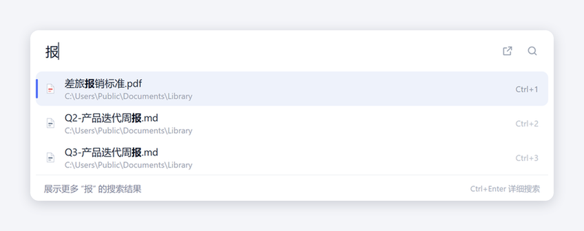
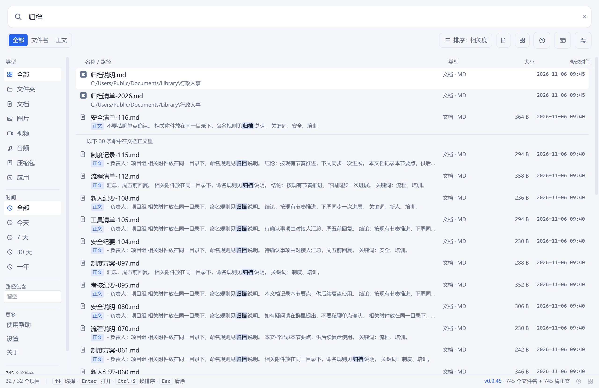
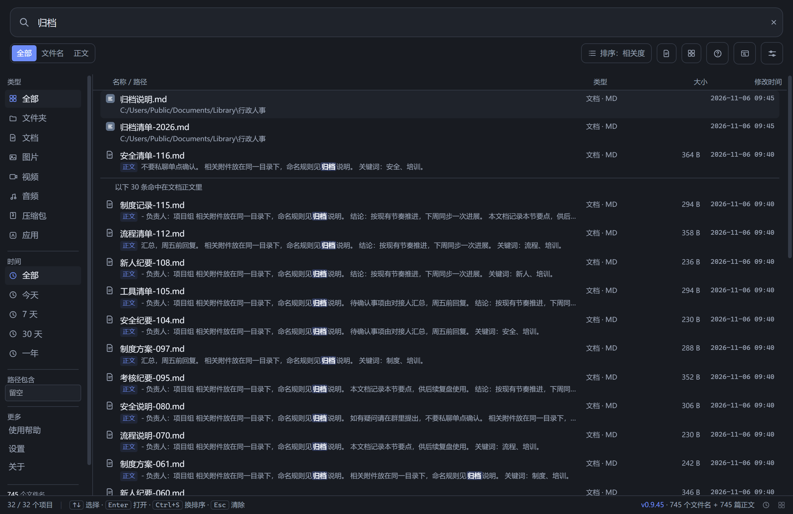
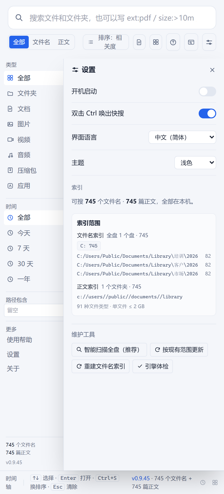

# 第二大脑 · Local Second Brain

**简体中文** | [English](README.en.md)

把你硬盘上散落多年的文档，变成一个能搜到内容的本地知识库。**全文搜索、中文友好、全程离线**——不传云端、不建账号、不依赖任何服务。

Python + SQLite FTS5 实现，一个 `brain.db` 装下所有正文，断网照用。

> **为什么不用 Everything**：它知道文件叫什么，不知道里面写了什么。你记得一句原文、却想不起存在哪份文件——这正是第二大脑要解决的问题。
> **为什么不用在线笔记**：合同、病例、内部资料不该上传到别人的服务器。

<p align="center"></p>

<p align="center"><sub>双击 Ctrl 弹出快搜窗。名字里有「归档」的排在前面，正文里提到「归档」的补在后面——两条路一起搜</sub></p>

---

## 下载安装

去 [Releases](https://github.com/bslnssb/second-brain/releases) 下最新的 `SecondBrain-Setup-vX.Y.Z.exe`（约 180 MB），双击安装。

| 项目 | 说明 |
|---|---|
| 系统 | Windows 10 / 11（64 位） |
| 安装后体积 | 约 330 MB（`SecondBrain.exe` + `_internal/`） |
| 是否需要管理员 | 不需要，装到当前用户目录即可 |
| 是否联网 | 安装后**全程离线**，OCR 模型已内置 |
| 是否卸载 | 设置 → 应用 → 卸载，或直接删安装目录 |

两个可能让你以为「装坏了」的地方，先说在前面：

1. **没有代码签名**，首次运行 Windows 会弹「已保护你的电脑」。点「更多信息」→「仍要运行」。这是没买证书的必然结果，不是中毒。
2. **缺 WebView2 会打不开窗口**（Win10 老机器偶发）。程序会提示下载地址，装完再启动即可；也可以直接用浏览器打开 `http://127.0.0.1:8765`。

安装完打开，第一次会引导你选要索引的文件夹，然后自动建库：**搜索框立刻可用**，结果随扫描进度变多。

## 它能做什么

- **双击 Ctrl 唤出快搜窗**：任何窗口里连按两下 Ctrl，屏幕上方弹出输入框；`↑↓` 选、`Enter` 开、`Ctrl+1~9` 直达第 N 条、`Ctrl+Enter` 在文件夹里定位、`Esc` 收起
- **文件名与正文一起搜**：名字命中走索引（毫秒级）；停手 300 ms 后自动补一次「正文里提到」的结果，带紫色标签和命中原句
- **拼音也能搜**：`azb` 出「安装包」，`xzrs` 出「行政人事」——首字母、全拼都认，`wx` 也能找到「微信」
- **真实系统图标**：每行是资源管理器里同一张图标（PDF 红、Word 蓝、Excel 绿、exe 是它自己的图标），不是自绘简笔
- **中文全文检索**：≥3 字走 FTS5 trigram 倒排（带高亮），1~2 字自动降级 LIKE 兜底
- **扫描件自动 OCR**：纯图片 PDF 自动识别前 6 页（单篇 20 秒预算），中文离线识别
- **索引范围看得见，也改得动**：设置里能看到扫了哪几个盘、各多少条、正文收了哪些文件夹、排除了什么；范围不对直接在里面增删文件夹和排除词，保存后点一次更新即可
- **维护进度跟随界面语言**：扫描 / 更新 / 重建索引 / 自检的每一句进度、每一条报错都按当前语言显示，切英文后不会突然冒中文
- **排除规则双层生效**：`exclude_dirs` 同时作用于文件名索引和正文索引，遍历时整枝剪掉（排除游戏库后，本机从 60 万条降到 20 万条）
- **增量维护**：改过的文件自动重索引，删掉的自动清理，没变的秒跳过；建几万篇时中断也没关系，重跑从断点继续
- **五语言界面**：中文 / English / Español / Português / हिन्दी，可跟随系统，也可手动切换
- **零上传**：解析、OCR、索引全在本机，服务只绑 `127.0.0.1`

## 界面

主窗口是「详细搜索」：文件名 / 正文分栏、命中原句高亮、按类型与路径过滤、按时间轴浏览。

<p align="center"></p>

<p align="center"></p>

设置面板里能直接看到索引范围，不用猜程序扫了什么：

<p align="center"></p>

快搜窗不打字时列最近打开的文件，大多数时候连搜索都省了：

<p align="center"></p>

## 它和 Everything / Listary 是什么关系

**如果你要的就是「双击 Ctrl 打字找文件」，装上第二大脑就够了。** 操作习惯按大家熟悉的做法来：双击 Ctrl 唤出、一行输入、九行结果、`Ctrl+1~9` 直达、`Esc` 收起、拼音模糊、真实图标、空状态列最近文件、路径分级显示。

**正文也能在快搜窗里出** —— 这两家都只看文件名，所以这一条是第二大脑独有的。

| | 找「我知道它叫什么」 | 问「哪句话在哪份文件里」 | 索引更新 |
|---|---|---|---|
| **Everything** | 最强，读 NTFS 文件表，实时 | 做不到 | 跟盘实时 |
| **Listary** | 强，带拼音和启动器 | 做不到 | 跟盘实时 |
| **第二大脑** | 够用：文件名 + 文件夹名（可排除游戏库，本机 20 万条），前缀约 0.2 ms，带拼音 | **快搜窗里就有** | 手动「重建文件名索引」 |

**它没做的部分也说清楚**：Listary 还能在「打开 / 保存」对话框里直接跳目录、在资源管理器里选中文件、索引跟着 NTFS 实时更新。所以如果你把 Listary 当「文件对话框加速器」用，两者不冲突，可以都装。

> 第二大脑是独立实现：没有使用上述任何产品的代码、图标或界面素材，与它们也没有隶属或授权关系。文中提到的产品名只用于说明差异。

## 第一次使用的完整流程

1. 双击 `SecondBrain.exe`，主窗口打开（关掉它不会退出，程序待在托盘里继续等双击 Ctrl）
2. 右上角进「设置」，点「智能扫描全盘」——程序自动找出值得索引的文件夹，列出来让你确认
3. 建库：正文索引与文件名索引都会自动开始，搜索框不用等
4. 日常维护：来了新文档点「按现有范围更新」；挪动了大批文件，点一次「重建文件名索引」

索引范围写在程序目录的 `scope.json` 里，两个字段就够：

| 字段 | 作用 |
|---|---|
| `include_dirs` | 要索引的目录（前缀匹配，也作为文件名索引的第一批扫描根） |
| `exclude_dirs` | 排除关键词，命中路径任意片段即跳过（文件名索引与正文索引都生效） |

另外还有一层保险：目录名含「小说 / 书城 / 书架 / novel / fiction / 轻小说 / 网文」的整棵子树零接触，连扫描清单里都不会出现。

## 搜索语法

直接输入关键词即可。多词用空格分隔、按 AND 组合，每个词都当字面短语处理——`C++`、`node.js`、`a-b`、`"引号"`、`(括号)` 都能直接搜，不会触发 FTS 语法错误。

主窗口的输入框支持几个前缀，边打边生效：

| 写法 | 含义 |
|---|---|
| `ext:pdf` | 只看这个扩展名 |
| `size:>10m` | 按大小过滤（`k` / `m` / `g`） |
| `dm:7d` | 只要最近 7 天改过的（`h` / `d` / `w` / `m` / `y`） |
| `-draft` | 排除含这个词的 |
| `folder/` | 只找文件夹 |
| `content:` | 只在正文里搜，不看文件名 |

文件名也参与检索：关键词只出现在文件名里、正文完全没提的文档照样能搜到，并且高亮文件名里的命中处。

## 命令行与自动化

exe 支持启动参数，方便挂到别的启动器上：

| 命令 | 效果 |
|---|---|
| `SecondBrain.exe 报销标准` | 开主窗口并直接出结果 |
| `SecondBrain.exe --settings` | 开主窗口并展开设置 |
| `SecondBrain.exe --silent` | 后台常驻，不显示窗口，只等双击 Ctrl |
| `SecondBrain.exe --mini` | 启动时直接弹出快搜窗 |
| `SecondBrain.exe --lang en 报销` | 强制英文界面（`zh` 同理） |

浏览器界面的 URL 参数：

| 参数 | 作用 |
|---|---|
| `?q=关键词` | 打开就出结果 |
| `?panel=settings` | 打开就展开设置（旧写法 `?cfg=1` 仍然有效） |
| `?lang=zh` / `?lang=en` | 这条链接强制用该语言 |

例：`http://127.0.0.1:8765/web/?q=报销标准&lang=zh`

**开机自启**：设置里有开关，也可以把快捷方式放进 `shell:startup` 并在目标后补 `--silent`。

## 从源码跑

需要 Python 3.10+（推荐 3.12）。

```bash
pip install -r requirements.txt
python app_window.py          # 桌面窗口（Windows 也可双击 start.bat）
python brain.py serve         # 或只用浏览器界面：http://127.0.0.1:8765
```

第一次用之前准备范围配置：

```bash
cp scope.example.json scope.json        # Windows: copy scope.example.json scope.json
```

把要索引的目录写进 `include_dirs`（反斜杠要写双份），然后：

```bash
python brain.py update        # 扫描 → 增量索引 → 清理
python brain.py index scope.json   # 只建正文索引（支持断点续建）
python brain.py search 关键词 [条数] [扩展名] [路径含]
python brain.py prune         # 只清理已删除文件的条目
python brain.py selftest      # 质量自检，报告写入 eval_report.txt
python scan_docs.py           # 只扫描磁盘，生成待索引清单
```

前端源码在 `web/`（React + TypeScript + Tailwind）。改了要重新构建：

```bash
cd web
npm install
npm run build      # 产物在 web/dist，后端直接读它
npm test           # 35 条单元测试
```

打 exe（Windows，需 PyInstaller）：

```bash
cd release/github
python -m PyInstaller --noconfirm --clean second-brain-app.spec && python -B stage_app.py
python -B make_payload.py && python -m PyInstaller --noconfirm --clean SecondBrain-Setup.spec && python -B stage_setup.py
```

## 支持的格式与限制

| 格式 | 支持 | 说明 |
|---|---|---|
| `.txt` / `.md` | 是 | 自动识别 UTF-8 / GBK / UTF-16，另有 gb18030 兜底 |
| `.pdf` | 是 | pypdf 抽前 20 页；纯扫描件自动 OCR 前 6 页（单篇 20 秒预算） |
| `.docx` / `.pptx` / `.xlsx` / `.epub` | 是 | zip + XML 解包取文本，无外部依赖 |
| `.html` / `.htm` | 是 | 去标签取正文 |
| `.rtf` | 是 | 去控制字；中文按文档自带 `\ansicpg` 代码页解码 |
| `.doc` / `.xls` / `.ppt` / `.wps` / `.et` / `.dps` | 看机器 | 借本机装的 Office / WPS 抽取；没装则记为「旧版格式」并跳过 |
| 加密文档 | 否 | 记为「加密」跳过，不会污染索引 |
| 单篇正文 | 2 MB 上限 | 超长部分截断，避免个别巨型文件拖垮索引 |

索引失败的文件会在库里记下原因（加密 / 损坏 / 空文件 / 临时文件 / 旧版格式），每轮结束汇总一行，一眼看出该补 OCR 还是该转格式，不会静默丢文件。

## 隐私

- 正文解析、OCR、索引全在本机完成，不发起任何网络请求
- HTTP 服务只绑 `127.0.0.1`，并校验 `Host` / `Origin`，`/api/*` 要求同源请求，POST 只收 `application/json` 且限制 64 KB
- 打开文件与读取缩略图的路径必须在索引内，不接受任意路径
- 索引库就是同目录的 `brain.db`，删掉即彻底清除
- 仓库 `.gitignore` 已排除 `brain.db`、`scan_raw.csv`、`scope.json` ——它们含你的正文和本机路径

### 只从官方地址下载

程序本身不联网，但**别人转给你的安装包可能不是这个项目发的**。判断办法两条：

- 仓库和发布页只认 **<https://github.com/bslnssb/second-brain>**
- 「关于」面板里有「官方地址」三行（互相可点开），不需要记网址
- 「关于」里还会显示赞赏码的 SHA-256 指纹；和本次发行版对不上时，**二维码会被自动隐藏**，不会让你扫到别人的收款码

v0.9.46 内置的赞赏码指纹：

```
07710ddf1ccf1d443275df5ffae15820609d7d34160af6438edf50455be835ee
```

> 这不是密码学意义上的签名（拿不到代码签名证书就做不到），但它把「换一张二维码」的成本从
> 「改一个 PNG」抬到了「重新打一个 exe」。要换自己的收款码，得同时改 `brain.py` 里的
> `DONATE_SHA256` —— 这是故意的。

## 质量自检

`python brain.py selftest` 用合成数据在临时目录建库，独立验证检索准确率、双 PDF 引擎交叉比对、OCR 字符错误率、畸形文件 fuzz、数据库完整性，全程不碰你的真实索引：

```
[PASS] A1 检索评测 recall@3 = 5/5 —— recall@1=5/5, MRR=1.000
[PASS] A2 相关度排序 —— bm25 排序生效
[PASS] A3 加密 PDF 不入库不可检索 —— 确认零泄漏
[PASS] B  双抽取器一致性 pypdf vs pymupdf = 1.00
[PASS] C  OCR 字符错误率 CER = 7.3%
[PASS] D  畸形文件 fuzz：9 例 —— 零崩溃
[PASS] E  SQLite/FTS5 完整性检查
[PASS] F  文件变更自动重索引
[PASS] G1 失败归因 / G2 prune 清理
OVERALL: PASS
```

还有一套发布前跑的 `qa_test.py`：边界输入（FTS 语法、通配符、注入形状、超长查询）、真实库延迟、并发请求、`/open` 越权、英文界面有没有漏中文。只读，跑完写 `QA_REPORT.md`。最近一次在 8,626 篇 / 2.37 GB 的库上：98 通过 / 0 失败 / 1 警告，抓到的 7 个缺陷记在 [QA_FINDINGS.md](QA_FINDINGS.md)。

## 目录结构

```
brain.py                核心：建索引 / 搜索 / HTTP 服务 / 清理 / 自检调度
scan_docs.py            磁盘扫描器（排除规则、小说关键词保险）
app_window.py           桌面窗口（pywebview）+ 高 DPI 适配
hotkey.py               全局双击 Ctrl 钩子
tray.py                 托盘图标与菜单
apprank.py              应用常用度与中文名映射
selftest.py             质量自检（合成数据）
qa_test.py              QA 套件：边界 / 延迟 / 并发 / 泄漏
ocr_backfill.py         把历史「提不出文本」的文件重走一遍
web/                    前端源码（React + TypeScript + Tailwind）
release/github/         打包脚本与安装器（PyInstaller specs）
assets/                 README 截图与应用图标
scope.example.json      范围配置模板
```

## 许可证

MIT
