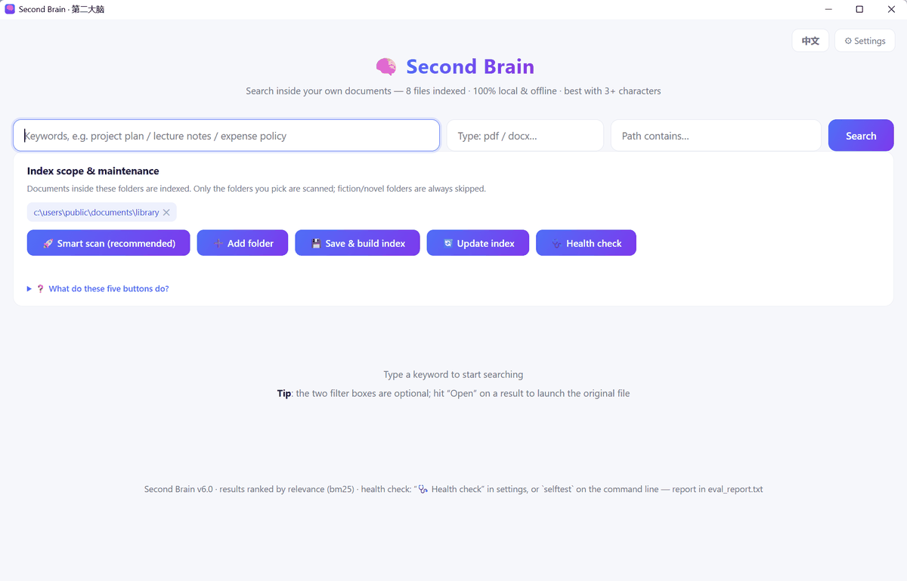

# 第二大脑 · Local Second Brain

**简体中文** | [English](README.en.md)

把你硬盘上散落多年的文档，变成一个能搜的本地知识库。**全文搜索、中文友好、全程离线**，不传云端、不建索引服务、不依赖任何账号。

Python + SQLite FTS5 实现，一个 `brain.db` 装下所有正文，断网可用。

> 为什么不是 Everything？它只知道文件叫什么，不知道里面写了什么。第二大脑两样都搜，但真正的价值在后者——你记得一句原文、却想不起存在哪份文件，这是它答不了的。
> 为什么不用在线笔记？你的合同、病例、内部培训资料不该上传到别人服务器。

---

<p align="center"></p>

<p align="center"><sub>同一份索引库，右上角切到 English 就是这样 —— 界面语言不影响索引内容</sub><br>
</p>

## 特性

- **中文全文搜索**：≥3 字走 FTS5 trigram 倒排（快且带高亮），1~2 字自动降级 LIKE 兜底
- **扫描件自动 OCR**：纯图片 PDF 自动识别前 15 页，离线中文识别（RapidOCR），装好后零联网
- **格式覆盖广**：PDF / DOCX / PPTX / XLSX / EPUB / RTF / HTML / TXT / MD
- **增量维护**：改过的文件自动重索引，删掉的自动清理，已索引的秒跳过
- **断点续建**：索引几万篇时中断也不要紧，重跑从断点继续
- **中英双语界面**：右上角有 中 / EN 切换，默认跟随系统语言，选择会记住
- **质量自检（少见但重要）**：`python brain.py selftest` 用合成数据独立验证检索准确率、双 PDF 引擎交叉比对、OCR 字符错误率、9 类畸形文件 fuzz、数据库完整性，报告可任何人重跑复核
- **零上传**：所有解析在本机完成，服务只绑 `127.0.0.1`

## 两种用法

| 方式 | 适合谁 | 怎么开始 |
|---|---|---|
| **下载 exe**（免安装） | 不想碰命令行 | 去 [Releases](https://github.com/bslnssb/second-brain/releases/latest) 下 `SecondBrain-Windows.zip`（带 OCR，下载 157MB，解压后约 320MB）或 `SecondBrain-Core-Windows.zip`（不带 OCR，下载 25MB，解压后约 52MB），解压到任意文件夹，双击 `SecondBrain.exe` 即开窗口 |
| **从源码跑** | 想改代码 / 想看清每一步 | 按下面「安装」走，装好依赖再启动 |

exe 版和源码版读写**同一个** `brain.db`，两者可以混用；把 exe 丢进已有索引库的目录，它会自动认旁边的库。

两个版本都是**整个文件夹**，不是单个文件：exe 旁边的 `_internal/` 是程序的一部分。
要移动就整夹移动——只把 exe 单独拎出来会打不开。

精简版只砍了 OCR，别的没动：扫描版 PDF 提不出文字（在失败归因里记为「无文本」），
文本型 PDF、Office、EPUB 等等表现完全一样。

## 安装

（exe 用户跳过本节——设置面板里的「🚀 智能扫描全盘」会替你完成这一切。）

需要 Python 3.10+（推荐 3.12）。

```bash
pip install -r requirements.txt
```

首次使用把范围配置准备好：

```bash
cp scope.example.json scope.json    # Windows: copy scope.example.json scope.json
```

编辑 `scope.json`，把你自己的目录写进 `include_dirs`（路径全小写，反斜杠要写成 `\\`）。

## 用法

### 图形界面（exe 的正常用法，全程不碰命令行）

1. 双击 `SecondBrain.exe` 打开窗口，搜索框里输关键词、回车，就能搜文件**内容**
2. **第一次使用**：点右上角「⚙ 设置 / 更新」，再点「🚀 智能扫描全盘」——程序会自动找出值得索引的文件夹，列出来让你确认后建库
3. **日常维护**：电脑里来了新文档，设置里点一下「🔄 按现有范围更新」（约 1~3 分钟）
4. 想确认引擎状态：设置里点「🩺 引擎体检」

设置面板——扫描、更新、体检都在这里，不用记任何命令：

<p align="center"></p>

<p align="center"><sub>同一面板切到 English 的样子：</sub><br>
</p>

### 和 Listary / Everything 是什么关系

**先说清楚：搜文件名这件事，第二大脑自己就能做，不需要装别的软件。**
设置里点「🗂 重建文件名索引」，它扫一遍全盘、只记名字不读内容（157 万个文件实测约 3 分钟），
之后安装包、图片、视频、压缩包都能按名字搜到，和已入库的文档并列显示。

**边界仍然在**：结果没法互相塞进对方的窗口。Listary 6 的插件接口还没公开，Everything 的列表也只认自己的索引——
所以「在 Listary 窗口里同时看到两种结果」做不到，这是它们的设计，不是配置能解决的。

能做的是反过来：**让第二大脑当主窗口，一次给两路结果**。

<p align="center"></p>

| 你手里的线索 | 出现在 |
|---|---|
| 文件名、文件夹名 | 📁 文件名命中（顶部，最多 6 条，来自全盘文件名索引） |
| 正文里的某句话 | 内容命中（下面，带命中片段并高亮） |

上图搜的是「国办发2019」：正文里没有，但文件名里有 2 个——不用换工具就找到了。
两栏互补：已经作为内容命中列出来的文件，不会在文件名栏再出现一次。

**那 Everything 还留着吗**：不冲突，各有快的地方。它的索引由 NTFS 文件表直接建成，
几百万个文件也是秒级，还跟着系统实时更新；第二大脑的文件名索引是一次扫描的静态快照，要手动重扫。

- 找「我知道它叫什么」的东西，Everything 更快、更新更勤
- 问「哪份文件里提过这句话」，只有第二大脑答得了
- 刚加了移动硬盘、挪了大批文件，去设置里点一次「🗂 重建文件名索引」

**Listary 值得配**，它的价值是「入口」：

| 命令 | 效果 |
|---|---|
| `SecondBrain.exe 报销标准` | 开窗并直接出结果 |
| `SecondBrain.exe --settings` | 开窗直接展开设置面板 |
| `SecondBrain.exe --lang en 报销` | 强制英文界面（`zh` 同理） |

在 Listary 里挂一条命令（选项 → 命令 → ➕）：关键字 `sb`、路径指向 `SecondBrain.exe`、参数 `"{query}"`。
之后任何地方双击 Ctrl，输 `sb 报销流程` 回车，第二大脑直接带着结果开窗。
同一个面板再给 Everything 配一条 `ev`（参数 `-search "{query}"`），
「`ev` 找文件名 / `sb` 找文件内容」就都在一个入口里了。

PowerToys Run、快捷方式、AutoHotkey 同理——只要能传参，就能直达结果，不用先开窗口再输入。

### 命令行（源码版进阶，exe 用户不需要）

```bash
python brain.py update              # 等价于设置里的「🔄 按现有范围更新」：重扫 → 增量索引 → 清理
python brain.py serve               # 打开网页界面 http://127.0.0.1:8765
python scan_docs.py                 # 只扫描磁盘，生成待索引清单（不读内容）
python brain.py index scope.json    # 只建索引（断点续建，实时显示 篇数/速率/ETA）
python brain.py search 关键词 [条数] [扩展名] [路径含]   # 命令行搜索
python brain.py prune               # 只清理已删除文件的条目
python brain.py selftest            # 质量自检，报告写入 eval_report.txt
```

### 桌面窗口版（源码用户）

不想看到命令行窗口，运行 `python app_window.py`（Windows 上也可双击 `start.bat`）：它用 pywebview 起一个**独立桌面窗口**
（不是浏览器标签页），背后跑本机的 HTTP 服务。没装 pywebview 时自动退回浏览器打开。
`update.bat` 是日常维护入口，等价于 `python brain.py update`。

## 索引范围配置

`scope.json` 两个关键字段：

| 字段 | 说明 |
|---|---|
| `include_dirs` | 要索引的目录，前缀匹配。路径写小写，Windows 反斜杠要双写 |
| `exclude_dirs` | 排除的关键词，命中路径任意片段即跳过 |

`scan_docs.py` 另有一层保险：目录名含「小说 / 书城 / 书架 / novel / fiction / 轻小说」等关键词的整棵子树零接触，连扫描清单里都不会出现。

**如果你的资料放在 `C:\Program Files` 这类系统目录下**（比如便携式部署），注意 `scan_docs.py`
的跳过名单里有这些目录。把该目录写进 `include_dirs` 后，它会自动作为独立扫描根加入
（v6.0 起支持），不会漏扫。

## 支持的格式与已知限制

| 格式 | 支持 | 说明 |
|---|---|---|
| .txt / .md | 是 | 自动识别 utf-8 / gbk / utf-16，另有 gb18030 兜底 |
| .pdf | 是 | pypdf 抽前 20 页；纯扫描件自动 OCR 前 15 页（单篇 60 秒预算） |
| .docx / .pptx / .xlsx / .epub | 是 | zip + XML 解包取文本，无外部依赖 |
| .html / .htm | 是 | 去标签取正文 |
| .rtf | 是 | 去控制字取正文；中文按文档自带的 `\ansicpg` 代码页解码，`\'b1\'a3` 这类 GBK 字节转义和 `\uNNNN` 都能正确还原 |
| .doc / .xls / .ppt / .wps / .et / .dps / .mobi | 否 | 旧版二进制 Office / 电子书格式，纯 Python 解析不可靠；建议先用 WPS 或 LibreOffice 批量转 .docx / .xlsx / .pptx |
| 企业加密文档 | 否 | 文件头异常的加密件会记为「加密」并跳过，不会污染索引 |
| 单文档正文 | 2MB 上限 | 超长部分截断，避免个别巨型文件拖垮索引 |

索引失败的文件会在 `meta` 表里记原因（加密 / 损坏 / 空文件 / 临时文件 / 旧版格式），
每轮索引结束会按原因汇总打印一行，一眼看出是该补 OCR 还是该转格式，不会静默丢失。

## 搜索语法

直接输入关键词即可。多个词用空格分隔，按 AND 组合；每个词都当字面短语处理，
所以 `C++`、`node.js`、`a-b`、`"引号"`、`(括号)` 都能直接搜，不会触发 FTS 语法错误。

**文件名也参与检索。** 关键词只出现在文件名里、正文里完全没有的文档照样能搜到，
并且会把文件名里的命中处高亮出来——搜「2026 预算」能找到 `2026预算草案.xlsx`，
哪怕表格里面一次都没写过这个词。

两个过滤框：**类型**填扩展名（`pdf`、`docx`…），**路径包含**按完整路径的子串过滤（不区分大小写）。

### URL 参数

收藏常用搜索、做快捷方式时好用：

| 参数 | 作用 | exe 里的等价写法 |
|---|---|---|
| `?q=关键词` | 打开就直接出结果 | `SecondBrain.exe 关键词` |
| `?cfg=1` | 打开就展开设置面板 | `SecondBrain.exe --settings` |
| `?lang=zh` / `?lang=en` | 这条链接强制用指定语言 | `SecondBrain.exe --lang en` |

例：`http://127.0.0.1:8765/?q=报销标准&lang=zh`

## 质量自检

下面是 `python brain.py selftest` 真实跑出来的输出（自己跑一次，完整报告会写到同目录的 `eval_report.txt`）：

```
[PASS] A1 检索评测 recall@3 = 5/5 —— recall@1=5/5, MRR=1.000
[PASS] A2 相关度排序 —— bm25 排序生效
[PASS] A3 加密 PDF 不入库不可检索 —— 确认零泄漏
[PASS] B  双抽取器一致性 pypdf vs pymupdf = 1.00
[PASS] C  OCR 字符错误率 CER = 7.3%
[PASS] D  畸形文件 fuzz：9 例 —— 零崩溃
[PASS] E  SQLite/FTS5 完整性检查
[PASS] F  文件变更自动重索引
[PASS] G1 失败归因 / G2 prune 清理
OVERALL: PASS
```

自检全程使用合成数据，在临时目录建库，**不碰你的真实索引**。

### QA 套件（发布前跑）

`selftest.py` 回答「功能对不对」，`qa_test.py` 回答「扛不扛得住」：边界输入
（FTS 语法、通配符、SQL 注入形状、5000 字长查询）、真实库上的延迟、并发请求、
资源泄漏、`/open` 接口的越权、以及英文界面有没有漏中文。只读，跑完写 `QA_REPORT.md`。

```
python qa_test.py            # 全量
python qa_test.py --quick    # 跳过并发与泄漏两节
```

最近一次在 8,626 篇 / 2.37 GB 的库上：**98 通过 / 0 失败 / 1 警告**。
抓到的 7 个缺陷连同修复前后的数字见 [QA_FINDINGS.md](QA_FINDINGS.md)。

## 隐私

- 正文解析、OCR、索引全部在本机完成，不发起任何网络请求
- HTTP 服务只绑 `127.0.0.1`，并校验 Host/Origin，POST 只接受 `application/json`
- 索引库就是同目录下的 `brain.db`，删掉即彻底清除
- 仓库里 `.gitignore` 已排除 `brain.db`、`scan_raw.csv`、`scope.json`——它们含你的文档正文和本机路径

## 目录结构

```
brain.py            核心：建索引 / 搜索 / 网页服务 / 清理 / 自检调度
scan_docs.py        磁盘扫描器（排除规则、小说关键词保险）
app_window.py       桌面窗口启动器（pywebview）
selftest.py         质量自检（合成数据）
qa_test.py          QA 套件：边界 / 延迟 / 并发 / 泄漏
ocr_backfill.py     把历史「提不出文本」的文件重走一遍索引
gen_icon.py         生成应用图标
scope.example.json  范围配置模板
start.bat           Windows：打开桌面窗口
update.bat          Windows：一键完成 重扫 → 索引 → 清理
build_exe.bat       Windows：打包两个版本的可执行程序（需 PyInstaller）
second-brain-app.spec   完整版打包配置（含 OCR）
second-brain-core.spec  精简版打包配置（不含 OCR）
assets/             README 里的界面截图与应用图标
README.en.md        本文档的英文版
QA_FINDINGS.md      发布前那轮 QA 查出的 7 个缺陷与前后数据
brain.db            （运行时生成）SQLite 索引库，docs=FTS5 表，meta=已处理清单
scan_raw.csv        （运行时生成）最近一次扫描清单
eval_report.txt     （运行时生成）最近一次自检报告
QA_REPORT.md        （运行时生成）最近一次 QA 套件报告
```

## 许可证

MIT
